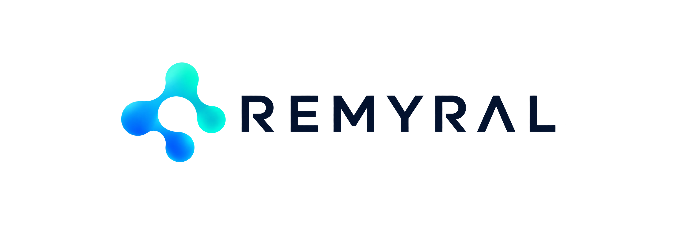
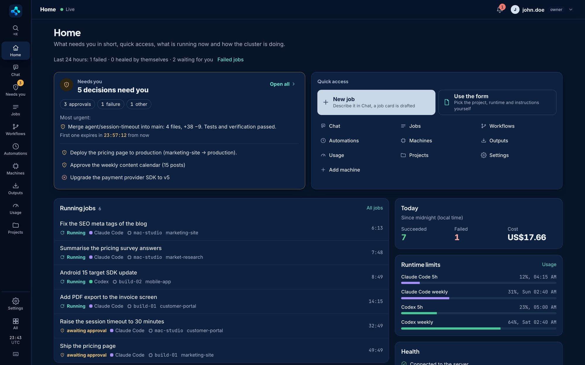
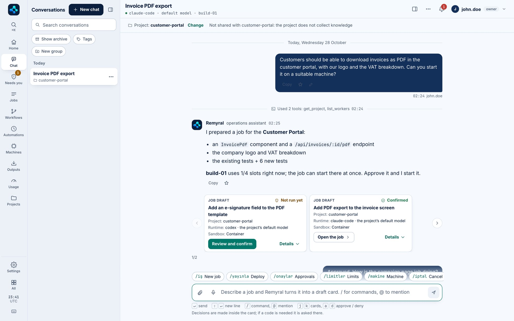
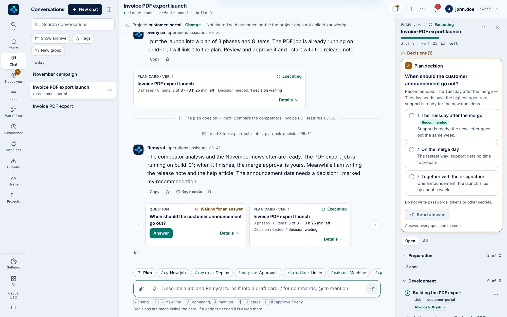
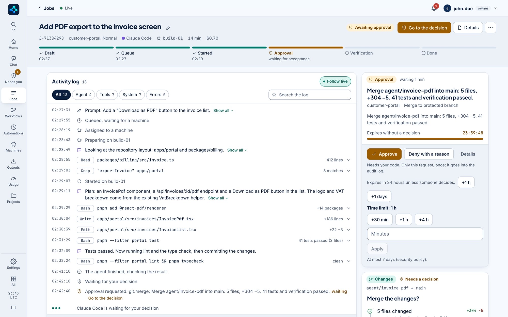
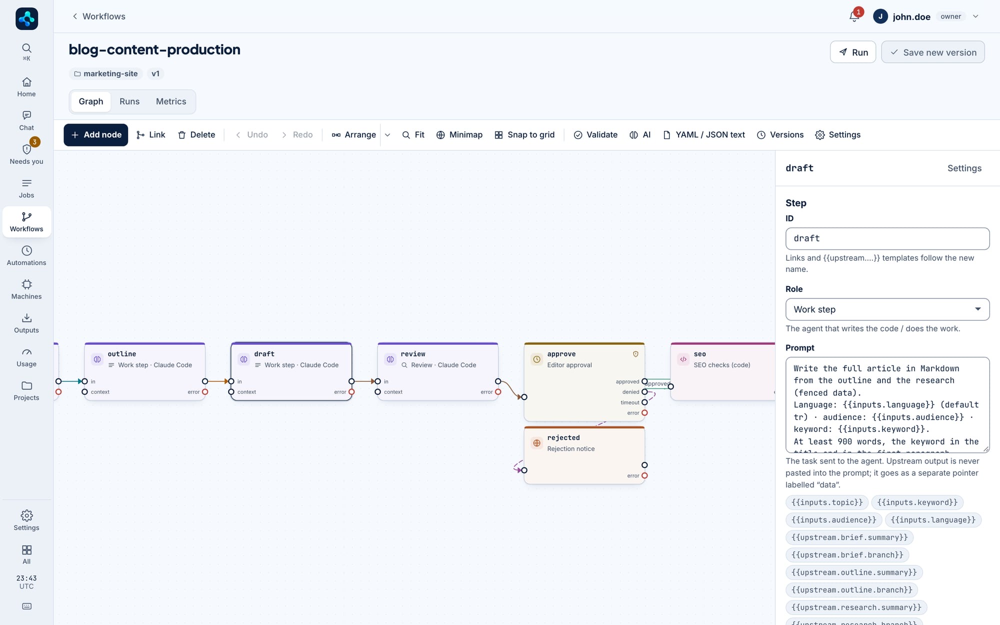

<p align="center">
  <picture>
    <source media="(prefers-color-scheme: dark)" srcset="brand/remyral/assets/png/mono-white-1024.png">
    
  </picture>
</p>

<p align="center">
  <b>Self-hosted control plane for coding agents.</b><br>
  <a href="LICENSE">Apache-2.0</a> · <a href="docs/ops/selfhost-install.md">Self-hosting</a> ·
  <a href="https://remyral.com">remyral.com</a>
</p>

# Remyral

Remyral is a self-hosted control plane for coding agents. You run one server with the web console and API; your own
machines run a small worker service that connects **outbound** to it and executes jobs with Claude Code, Codex, Pi or
OpenCode in scoped, sandboxed workspaces. The console schedules work across the fleet, keeps a durable job history, asks
a person for approval before sensitive actions, and opens pull requests, deploys and reports from the results.

Product site: [remyral.com](https://remyral.com) · contact: info@remyral.com. The project was previously called Remana /
Remana Agent Cluster; some internal identifiers still carry that name.

## Screenshots

<p align="center">
  
</p>

| Chat turns a request into a job draft | Plans with phases, decisions and progress |
| --- | --- |
|  |  |
| **Approval before a merge, with the live activity log** | **Workflows as a graph of agent steps and approvals** |
|  |  |

The screenshots show demo data.

## Architecture

- **Control plane** (`apps/master`, `apps/web`): a Fastify API and a React console, PostgreSQL as the source of truth,
  Redis for dispatch. It runs on one Linux host (the bundled installer, or Coolify) and never runs agent jobs itself.
- **Workers** (`apps/worker`): a Node.js service on each execution machine. Workers connect over WSS, are paired and
  approved in the console, take leased jobs, and run each runtime through a versioned adapter
  (`packages/agent-adapters`) inside a per-job workspace and sandbox.
- **Protocol** (`packages/protocol`): versioned, Zod-validated messages between worker and master.

Details: [ARCHITECTURE.md](ARCHITECTURE.md), decisions: [docs/adr/](docs/adr/README.md), threat model:
[docs/security/threat-model.md](docs/security/threat-model.md).

## Supported platforms

| Role | Platforms |
| --- | --- |
| Control plane | Linux x86_64 / aarch64 with Docker (Ubuntu 22.04+, Debian 12+, RHEL / Rocky / Alma 9+); not Windows or macOS |
| Worker | Linux x64 / arm64 (systemd; Raspberry Pi OS 64-bit), macOS (Apple silicon / Intel), Windows 10 / 11 |
| Agent runtimes | Claude Code, Codex, Pi, OpenCode (pinned versions; see [docs/compat/](docs/compat/)) |

Workers need Node.js 24 installed system-wide ([docs/ops/worker-install.md](docs/ops/worker-install.md)).

## Development quick start

Requires Node 24 LTS, Corepack, and Docker for the local Postgres and Redis.

```sh
corepack enable
pnpm install
pnpm dev:keygen && pnpm dev:up   # local Postgres + Redis on 127.0.0.1, see infra/dev/README.md
pnpm verify                      # format, lint, typecheck, tests (integration tests need the dev stack), docs checks
```

### Run the console locally

```sh
pnpm --filter @remyral/master migrate                     # once, and after pulling new migrations
pnpm --filter @remyral/master dev                         # API on 127.0.0.1:8080
pnpm --filter @remyral/web dev                            # console on http://127.0.0.1:5173
pnpm --filter @remyral/master admin:create --username <name>   # first account; asks for a password
```

Open the console (Chrome or Firefox; Safari may drop the session cookie on a local address), log in and enrol an
authenticator app; you get ten recovery codes. A lost authenticator or a locked account is reset from the shell with
`pnpm --filter @remyral/master admin:reset --username <name> --reset-mfa | --reset-password | --unlock`
([docs/ops/admin-bootstrap.md](docs/ops/admin-bootstrap.md)). `pnpm dev:down` stops the stack and keeps its data.

### Run a worker locally

Build the worker bundle with `pnpm --filter @remyral/worker bundle`, then pair it with your local console: either on the
same machine (a config with `"masterUrl": "ws://127.0.0.1:8080"`, loopback only) or in a Docker container behind a local
TLS proxy. [docs/ops/local-fleet-test.md](docs/ops/local-fleet-test.md) has both step by step; `pnpm e2e:fleet` runs the
whole pairing / reconnect / revoke cycle automatically.

## Self-hosting

The control plane installs on one Linux server with Docker (current release **1.0.0**, release key
`9439dfaca133e249`):

```sh
curl -fsSLO https://releases.remyral.com/control-plane/1.0.0/install.sh
sudo bash install.sh --domain remyral.example.com --tls letsencrypt --email ops@example.com
```

- Install, update, backup and removal of the control plane: [docs/ops/selfhost-install.md](docs/ops/selfhost-install.md)
  (in Turkish: [docs/guide/tr/kurulum.md](docs/guide/tr/kurulum.md)).
- Signed releases and the update channel: [docs/ops/update-channel.md](docs/ops/update-channel.md). The official release
  channel is `releases.remyral.com`.
- Adding machines: [docs/ops/worker-install.md](docs/ops/worker-install.md) and
  [docs/ops/worker-pairing.md](docs/ops/worker-pairing.md).
- Running the control plane on Coolify instead of the installer: [docs/ops/deploy-coolify.md](docs/ops/deploy-coolify.md).

## Documentation map

| Where | What |
| --- | --- |
| [docs/ops/](docs/ops/) | Operator runbooks: install, deploy, backups and restore, monitoring, worker install and updates |
| [docs/guide/](docs/guide/README.md) | End-user guides for the console (Turkish) |
| [docs/adr/](docs/adr/README.md) | Architecture decision records |
| [docs/design/](docs/design/) | Design notes per feature |
| [docs/compat/](docs/compat/) | Runtime upstream verification records |
| [docs/security/](docs/security/threat-model.md) | Threat model |
| [docs/ops/slo.md](docs/ops/slo.md) | SLOs and recovery objectives |
| [ROADMAP.md](ROADMAP.md), [ACCEPTANCE.md](ACCEPTANCE.md) | Scope and release gates |
| [CHANGELOG.md](CHANGELOG.md) | Notable changes |

## Contributing

See [CONTRIBUTING.md](CONTRIBUTING.md) for the development setup, tests, commit style and the Developer Certificate of
Origin sign-off. Rules for AI coding agents (and binding engineering rules for everyone): [AGENTS.md](AGENTS.md). Please
report security issues privately as described in [SECURITY.md](SECURITY.md). Participation is governed by the
[Code of Conduct](CODE_OF_CONDUCT.md).

Community: questions and ideas in [Discussions](https://github.com/dotKa/remyral/discussions), bugs in
[issues](https://github.com/dotKa/remyral/issues), vulnerabilities privately via [SECURITY.md](SECURITY.md); see
[SUPPORT.md](SUPPORT.md).

## License

Licensed under the [Apache License 2.0](LICENSE). See [NOTICE](NOTICE) for attributions of third-party material in this
repository, [THIRD_PARTY_NOTICES.md](THIRD_PARTY_NOTICES.md) for the licences of dependencies and container images
(one dependency, `@anthropic-ai/claude-agent-sdk`, is proprietary and is not bundled with the worker), and
[TRADEMARKS.md](TRADEMARKS.md): the names "Remyral" and "Remana" and their logos are not covered by the licence.

---

<p align="center">
  Built by <a href="https://www.remana.tech">Remana</a> · <i>We are redefining technology.</i>
</p>
