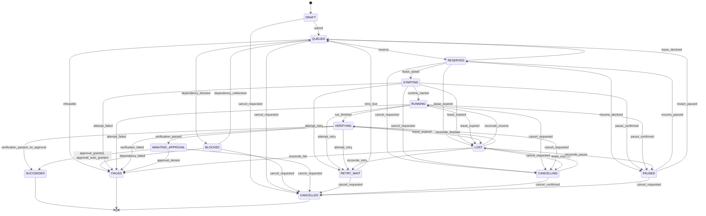

# Job state machine (`@remyral/scheduler`)

- **Status:** Implemented
- **Date:** 2026-10-13
- **Backlog:** p4-job-store
- **Source of truth:** `packages/scheduler/src/transitions.ts`. The diagram and table below are generated
  from it; `packages/scheduler/test/diagram.test.ts` fails when they are stale. Regenerate with
  `pnpm --filter @remyral/scheduler docs:diagram`.
- **Design and persistence:** [p4-job-store.md](p4-job-store.md)

14 states, 25 triggers, 41 legal transitions; every other (state, trigger) pair — 309 of 350 — is
rejected. `SUCCEEDED`, `FAILED` and `CANCELLED` are terminal and immutable. Guards on top of the table:

- **Actors:** each transition lists the actor types (`user`, `worker`, `system`) that may cause it.
  Approvals are human-only (ADR-0010). Workers may only report progress on their own attempt (and the
  store additionally requires their current fencing epoch, ADR-0004).
- **Reason:** cancellations, failures, retries and every reconciliation decision need a non-empty reason.
- **Retry-safe:** every transition into `RETRY_WAIT` requires the caller to assert that rerunning is safe
  (ADR-0004 §5: idempotent step, or reconciliation verified no unsafe side effects).
- **LOST:** a lease expiry always leads to `LOST`. `LOST` is left only by a reconciliation decision
  (`reconcile_resume` of the same attempt under a new epoch, `reconcile_finished` for a result produced
  while disconnected, `reconcile_retry` with the retry-safe assertion, `reconcile_fail`) or by
  cancellation — never directly back to `QUEUED`/`RESERVED`/`STARTING` and never by a worker (ADR-0003 §3:
  "reconciliation, not blind rerun").

<!-- BEGIN GENERATED: pnpm --filter @remyral/scheduler docs:diagram -->

| From | Trigger | To | Actors | Reason | Retry-safe | Meaning |
| --- | --- | --- | --- | --- | --- | --- |
| DRAFT | `submit` | QUEUED | user, system |  |  | draft submitted for scheduling |
| DRAFT | `cancel_requested` | CANCELLED | user, system | yes |  | draft discarded |
| QUEUED | `reserve` | RESERVED | system |  |  | scheduler picked a worker; attempt + lease created |
| QUEUED | `dependency_blocked` | BLOCKED | system |  |  | an upstream dependency is not complete |
| QUEUED | `infeasible` | FAILED | system | yes |  | no eligible worker can ever run the job |
| QUEUED | `cancel_requested` | CANCELLED | user, system | yes |  | cancelled before assignment |
| BLOCKED | `dependency_unblocked` | QUEUED | system |  |  | all dependencies succeeded |
| BLOCKED | `dependency_failed` | FAILED | system | yes |  | an upstream dependency failed |
| BLOCKED | `cancel_requested` | CANCELLED | user, system | yes |  | cancelled while blocked |
| RESERVED | `lease_acked` | STARTING | worker |  |  | worker acknowledged the lease |
| RESERVED | `lease_declined` | QUEUED | worker |  |  | worker declined before starting anything |
| RESERVED | `lease_expired` | LOST | system |  |  | no acknowledgement before lease expiry |
| RESERVED | `resume_declined` | PAUSED | worker | yes |  | worker could not resume the paused attempt (workspace gone or busy) |
| RESERVED | `cancel_requested` | CANCELLING | user, system | yes |  | cancel sent to the worker |
| STARTING | `runtime_started` | RUNNING | worker |  |  | runtime session spawned |
| STARTING | `attempt_failed` | FAILED | worker, system | yes |  | setup failed |
| STARTING | `attempt_retry` | RETRY_WAIT | user, system | yes | yes | setup failed; retry is safe |
| STARTING | `lease_expired` | LOST | system |  |  | lease expired during setup |
| STARTING | `cancel_requested` | CANCELLING | user, system | yes |  | cancel sent to the worker |
| STARTING | `pause_confirmed` | PAUSED | worker | yes |  | paused while waiting for an approval |
| RUNNING | `run_finished` | VERIFYING | worker |  |  | runtime finished; result collected |
| RUNNING | `attempt_failed` | FAILED | worker, system | yes |  | run failed or exceeded its limits |
| RUNNING | `attempt_retry` | RETRY_WAIT | user, system | yes | yes | run failed; retry is safe |
| RUNNING | `lease_expired` | LOST | system |  |  | lease expired while running |
| RUNNING | `cancel_requested` | CANCELLING | user, system | yes |  | cancel sent to the worker |
| RUNNING | `pause_confirmed` | PAUSED | worker | yes |  | paused while waiting for an approval |
| VERIFYING | `verification_passed` | AWAITING_APPROVAL | worker, system |  |  | verified; needs approval |
| VERIFYING | `verification_passed_no_approval` | SUCCEEDED | worker, system |  |  | verified; policy requires no approval |
| VERIFYING | `verification_failed` | FAILED | worker, system | yes |  | verification failed |
| VERIFYING | `attempt_retry` | RETRY_WAIT | user, system | yes | yes | verification failed; retry is safe |
| VERIFYING | `lease_expired` | LOST | system |  |  | lease expired while verifying |
| VERIFYING | `cancel_requested` | CANCELLING | user, system | yes |  | cancel sent to the worker |
| AWAITING_APPROVAL | `approval_granted` | SUCCEEDED | user |  |  | a human approved the result |
| AWAITING_APPROVAL | `approval_denied` | FAILED | user | yes |  | a human rejected the result |
| AWAITING_APPROVAL | `approval_auto_granted` | SUCCEEDED | system | yes |  | the owner's security policy approved the result |
| AWAITING_APPROVAL | `cancel_requested` | CANCELLED | user, system | yes |  | cancelled before approval |
| RETRY_WAIT | `retry_due` | QUEUED | system |  |  | backoff elapsed; requeued as a new attempt |
| RETRY_WAIT | `cancel_requested` | CANCELLED | user, system | yes |  | cancelled during backoff |
| CANCELLING | `cancel_confirmed` | CANCELLED | worker, system |  |  | worker or reconciler confirmed stop |
| CANCELLING | `lease_expired` | LOST | system |  |  | no cancel confirmation before lease expiry |
| LOST | `reconcile_resume` | RUNNING | user, system | yes |  | same attempt still alive; new lease |
| LOST | `reconcile_finished` | VERIFYING | user, system | yes |  | attempt finished while lost |
| LOST | `reconcile_retry` | RETRY_WAIT | user, system | yes | yes | verified no unsafe side effects |
| LOST | `reconcile_fail` | FAILED | user, system | yes |  | reconciliation could not recover |
| LOST | `cancel_requested` | CANCELLING | user, system | yes |  | cancel pending reconciliation |
| LOST | `reconcile_pause` | PAUSED | user, system | yes |  | a resume of a paused attempt never started; paused again |
| PAUSED | `resume_paused` | RESERVED | user, system | yes |  | resume on the same machine; new lease |
| PAUSED | `restart_paused` | QUEUED | user, system | yes |  | restart from scratch as a new attempt |
| PAUSED | `cancel_requested` | CANCELLED | user, system | yes |  | cancelled while paused |

<!-- END GENERATED -->
